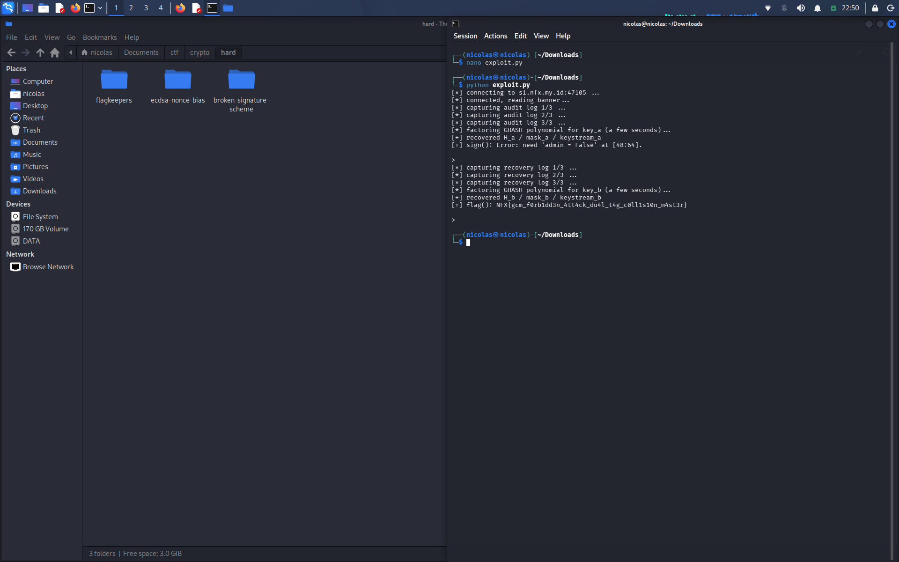

# Writeup — FlagKeepers (VaultGate)

## Soal

Dikasih source `app.py`. Service-nya namanya VaultGate, punya 2 konteks enkripsi AES-GCM yang terpisah:

- `key_a` buat audit log (opsi 1) dan dipakai buat cek "Sign" (opsi 3)
- `key_b` buat recovery log (opsi 2) dan dipakai buat ambil flag (opsi 4)

```python
nonce = urandom(12)   # cuma di-generate sekali di awal program

def encrypt(key, pt):
    ct, tag = AES.new(key, AES.MODE_GCM, nonce=nonce).encrypt_and_digest(pt)
    return ct, tag
```

Nonce-nya global, dipakai berkali-kali buat semua enkripsi, baik pake `key_a` maupun `key_b`. Ini pelanggaran fatal di GCM — nonce harusnya cuma boleh dipake sekali per key.

## Bug yang dieksploit

Reuse nonce di GCM ngebuka 2 celah:

### 1. Keystream bocor

Server ikut nge-print plaintext-nya tiap kali kita pilih opsi 1/2:

```
Log [AUDIT|ts=...|r=...|t=...|OK]
CT: ...
Tag: ...
```

Jadi `keystream = ct XOR plaintext` langsung bisa dihitung. Karena format & panjang pesan selalu sama tiap request, keystream ini valid dipake lagi buat enkripsi plaintext apapun yg kita bikin sendiri (asal key & panjang sama) — GCM mode-nya CTR, keystream nggak bergantung ke isi plaintext, cuma ke key+nonce+posisi block.

### 2. Forbidden attack (GHASH)

Tag GCM dihitung:

```
tag = GHASH_H(ct) XOR E_K(J0)
```

`H` dan `E_K(J0)` sama-sama konstan selama key & nonce sama. Kalo kita punya 2 pasang `(ct, tag)` di key+nonce yang sama, pas di-XOR:

```
tag1 XOR tag2 = GHASH_H(ct1) XOR GHASH_H(ct2)
```

`E_K(J0)` ilang (coret), sisa persamaan polinomial dalam `H` doang. GHASH sendiri emang didefinisikan sebagai evaluasi polinomial di GF(2^128), jadi persamaan ini bisa difaktorin buat nyari akar = `H` yang asli. Begitu `H` ketemu, `E_K(J0)` (mask tag) juga bisa dihitung balik dari salah satu pasangan.

Hasilnya: kita bisa bikin tag yang valid buat ciphertext APAPUN yang kita pilih sendiri, tanpa pernah tau key-nya. Tinggal gabung sama keystream yang udah bocor di poin 1 → bisa forge pesan bebas yang keenkripsi & ke-authenticate dengan benar.

## Kenapa dua-duanya butuh diforge

- Opsi 3 (`sign`) decrypt pake `key_a`, syaratnya: nggak ada `"admin = True"` di pesan, tapi harus ada `"admin = False"` persis di byte `[idx:idx+16]` (`idx` ini internal counter yang naik 16 tiap kali opsi 1 dipanggil, turun 16 tiap opsi 2).
- Opsi 4 (`flag`) decrypt pake `key_b`, syaratnya: ada `"admin = True"` sebelum posisi `idx`, dan nggak ada `"admin = False"` sama sekali di pesan.

Berarti butuh forge dua payload valid terpisah, satu buat tiap key, biar lolos dua-duanya.

## Langkah exploit

1. Panggil opsi 1 (audit) beberapa kali → kumpulin pasangan `(ct, tag)` di `key_a`.
2. Dari situ recover `H_a` (faktorin polinomial GHASH di GF(2^128) pake lib `galois`) dan `mask_a = E_{key_a}(J0)`.
3. Ambil keystream_a dari salah satu capture (`ct XOR plaintext yang kebaca`).
4. Susun plaintext palsu dengan `"admin = False"` tepat di window `[idx:idx+16]`, encrypt pake keystream_a, tag-nya dihitung pake `H_a` + `mask_a`. Kirim ke opsi 3 → lolos.
5. Ulangi hal yang sama buat `key_b` lewat opsi 2 → dapet `H_b`, `mask_b`, `keystream_b`.
6. Susun plaintext palsu dengan `"admin = True"` di awal pesan, tanpa `"admin = False"` sama sekali. Encrypt & tag pake `H_b`/`mask_b`. Kirim ke opsi 4 → keluar flag.

## Hasil

```
[+] sign(): OK
[+] flag(): NFX{gcm_f0rb1dd3n_4tt4ck_du4l_t4g_c0ll1s10n_m4st3r}
```


