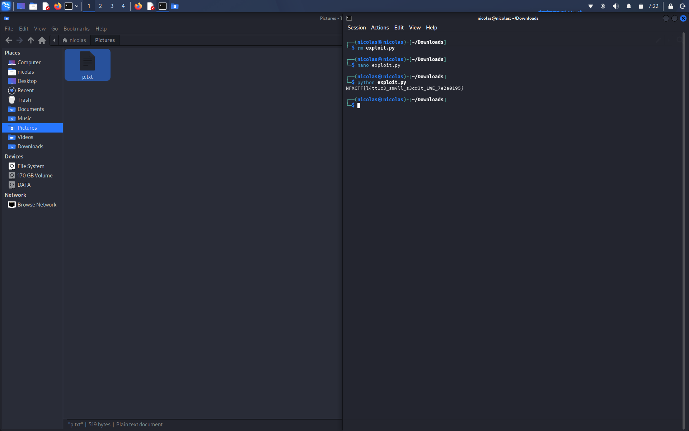

# LWE - Post-Quantum Key Exchange


## Soal

Vendor ngeklaim key exchange "post-quantum" mereka mustahil dibobol. Tapi transkripnya kesadap dan flag-nya ikut terenkripsi di dalamnya. Semua data ada di `lwe_1_.py`.

Isi file:

```python
q = 257
n = 40
m = 64
A = [[...], ...]   # 64 x 40
b = [...]          # 64 angka
ct = "8c8d8b0001438b..."   # 41 byte hex
```

Gak ada source enkripsi sama sekali, cuma parameter dan data publiknya.

## Analisis

Ini LWE biasa:

```
b = A·s + e  (mod q)
```

- `A` publik (64x40), `s` secret (40), `e` noise kecil (64)
- `q = 257`, `n = 40`

Parameternya kecil banget. `n = 40` itu jauh di bawah yg dipakai scheme beneran (ratusan sampai ribuan). Dgn dimensi segini lattice reduction masih sanggup, jadi tinggal cari `e` (atau `s`), terus `ct` bisa dibuka.

## Solve

### 1. Embedding lattice

Pakai Kannan embedding. Lattice q-ary dari kolom `A` + `q·I`, terus `b` ditambah sbg baris target dgn koordinat terakhir `1`:

```
[ A^T | 0 ]     (40 baris)
[ qI  | 0 ]     (64 baris)
[ b   | 1 ]     (1 baris)
```

Kalau `b - A·s = e` kecil, maka vektor `(e, 1)` ada di lattice dan pendek. Tinggal reduksi pakai LLL lalu BKZ (fpylll) dan cari baris yg koordinat terakhirnya ±1.

### 2. Salah kandidat dulu

Percobaan pertama pakai BKZ block size 10. Dapet vektor dgn norma ~19.8, lalu `s` di-recover pakai gauss mod 257. Dekripsi gagal terus.

Penyebabnya, estimasi Gaussian heuristic lattice ini ~15.6, jadi vektor sepanjang 19.8 itu banyak banget (ratusan ribu) dan hampir semuanya palsu. Cek "konsisten dgn `A·s = b - e`" juga gak guna krn semua vektor lattice otomatis lolos.

BKZ dinaikin ke block size 20-40, dan muncul vektor yg jelas beda:

| block size | norma terpendek (last coord ±1) | kandidat berikutnya |
|---|---|---|
| 10 | 19.1 | 19.7 |
| 20 | **10.2** | 18.5 |
| 40 | **10.2** | 15.8 |

Norma 10.2 dgn `e ∈ [-2, 2]`, jauh di bawah heuristic, jadi ini `e` yg asli.

### 3. Recover `s`

`s = A⁻¹ (b - e) mod q` lewat eliminasi gauss. Hasilnya ternary:

```
s = [1, 0, -1, 1, 0, 0, 0, -1, 1, 1, 0, 1, 0, -1, 0, 1, 0, -1, 0, 1,
    -1, 1, -1, 0, 0, 1, -1, -1, -1, 0, 1, 0, -1, 0, 0, -1, -1, 1, 1, -1]
```

(di mod 257 -1 muncul sbg 256). Semua entri ∈ {-1, 0, 1}, ini cek yg bener utk mastiin `s` asli, bukan vektor palsu.

### 4. Dekripsi `ct`

Cara turunin key dari `s` gak dikasih di file, jadi di-brute: coba beberapa encoding `s` (bytes, csv, json, dll) x hash (md5, sha1, sha2, sha3, blake2) x mode (langsung, counter). Cek hasil XOR-nya printable dan keliatan kayak flag.

Yg cocok:

```
key_i = SHA256( bytes(s & 0xff) || i_as_uint32_BE )   i = 0, 1, ...
flag  = ct XOR (key_0 || key_1 || ...)
```

`s & 0xff` artinya -1 jadi `0xff`. Di percobaan awal sempat salah krn 256 dibuat jadi 0 (`256 % 256`).

Hasil dekripsi:

```
NFXCTF{l4tt1c3_sm4ll_s3cr3t_LWE_7e2a0195}
```

## Solver

`solve.py` jalan end-to-end (~3 detik di laptop biasa):

```
pip install fpylll cysignals
python3 solve.py lwe_1_.py
```

Output:

```
[-] bkz-10: belum ketemu
[+] bkz-20: |e|=10.15, e in [-2,2]
[+] s = [1, 0, -1, 1, 0, 0, 0, -1, ...]
[+] flag: NFXCTF{l4tt1c3_sm4ll_s3cr3t_LWE_7e2a0195}
```

## Flag



```
NFXCTF{l4tt1c3_sm4ll_s3cr3t_LWE_7e2a0195}
```
