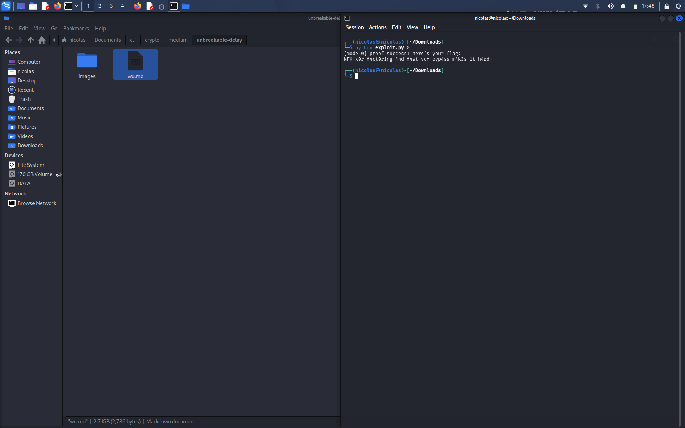

# Unbreakable Delay

## Deskripsi

Server minta bukti (π) VDF gaya Fiat-Shamir buat operasi `g^(2^(2^256)) mod n`. Kalau dihitung normal butuh waktu triliunan tahun, jd harus cari jalan pintas.

```
nc s1.nfx.my.id 41064
```

Server ngasih:
- `n` (modulus)
- hint `p ^ q`
- nilai `y = g^(2^(2^256))`
- `challenge`

## Analisis

VDF ini aman krn orang yg nggak tau faktor `n` cuma bisa kuadratin berulang-ulang sebanyak 2^256 kali. Tapi kalo tau `p` dan `q`, hitungnya jd gampang lewat order grup:

```
2^T mod φ(n)  ->  g^(2^T) mod n
```

Masalahnya `n` nggak dikasih faktornya. Tapi ada hint `p ^ q` (XOR), dan itu bocor banget.

## Faktorisasi n

Kalo `p ^ q` diketahui, bit `q` bisa dihitung dari bit `p`. Jadi faktorin dari bit paling rendah:

1. Mulai dari bit ke-0 (p dan q sama-sama ganjil, jd 1).
2. Di tiap bit ke-k, coba bit p = 0 atau 1. Bit q = bit p XOR bit hint ke-k.
3. Simpan kandidat yg `(p*q) mod 2^(k+1) == n mod 2^(k+1)`, sisanya dibuang.
4. Lanjut sampe 1024 bit, lalu cek `p*q == n`.

Kandidatnya nggak meledak krn tiap bit langsung disaring sama syarat perkalian.

```python
def factor(n, x, bits=1024):
    stack = [(1, 1, 1)]
    while stack:
        p, q, k = stack.pop()
        if k == bits:
            if p * q == n:
                return p, q
            continue
        for pb in (0, 1):
            qb = pb ^ ((x >> k) & 1)
            P = p | (pb << k)
            Q = q | (qb << k)
            if (P * Q) % (1 << (k + 1)) == n % (1 << (k + 1)):
                stack.append((P, Q, k + 1))
```

## Cari g

`g` nggak ditampilin di server. Setelah dapet `p` dan `q`, hitung `e = 2^(2^256) mod φ(n)`, lalu coba `g` kecil sampe `g^e mod n == y`. Hasilnya `g = 3`.

## Bikin Proof

Proof Wesolowski:

```
π = g^floor(2^T / l) mod n
```

`l` didapet dari hash (g, y, challenge). Krn φ(n) udah diketahui, eksponennya nggak perlu dihitung penuh:

```python
M = pow(2, T, l * phi)
e = (M - pow(2, T, l)) // l
pi = pow(g, e, n)
```

`l` yg dipake server: `...`

## Solver

Script ngoneksi ke server, faktorin `n`, hitung π, lalu kirim.

```python
import re, hashlib
from pwn import *
from sympy import nextprime

# factor() sama kyk di atas

io = remote("s1.nfx.my.id", 41064)
data = io.recvuntil(b"(pi):").decode()
n = int(re.search(r"modulus is (\d+)", data).group(1))
x = int(re.search(r"\(p \^ q\) is (\d+)", data).group(1))
y = int(re.search(r"== (\d+)", data).group(1))
c = int(re.search(r"challenge is (\d+)", data).group(1))

p, q = factor(n, x)
phi = (p - 1) * (q - 1)
g, T = 3, 2**256

l = ...  # sesuai hash server

M = pow(2, T, l * phi)
e = (M - pow(2, T, l)) // l
pi = pow(g, e, n)

io.sendline(str(pi).encode())
print(io.recvall().decode())
```

## Flag
NFX{x0r_f4ct0r1ng_4nd_f4st_vdf_byp4ss_m4k3s_1t_h4rd}


