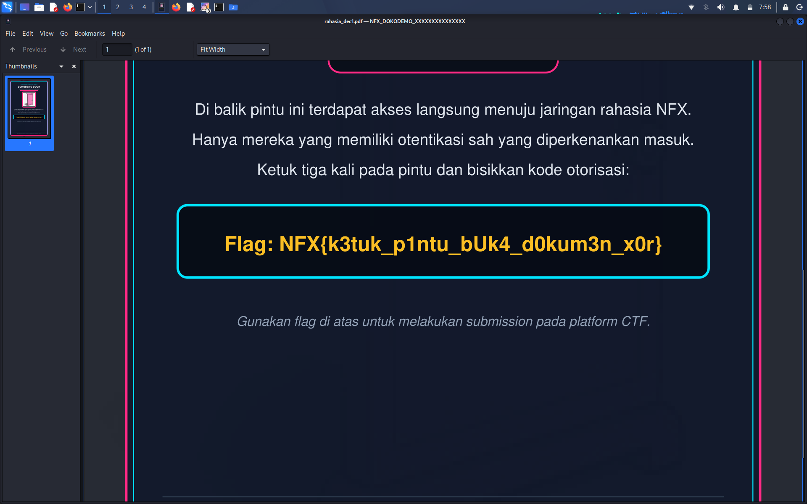

# Write Up - Dokodemo Door

## Deskripsi

Dokumen PDF rahasia yg isinya jalur penyusupan ke sektor barat berhasil dicegat, tapi ga bisa dibuka karena byte nya diacak pake repeating-key XOR. Tugasnya balikin PDF nya ke bentuk asli terus cari flag.

File: `rahasia.pdf`

## Solve

### 1. Cek file

```bash
wget 'https://raw.githubusercontent.com/NFCC-Com/qazwsx/refs/heads/main/crypto/Dokodemo_Door/rahasia.pdf' -O rahasia.pdf
file rahasia.pdf
```

`file` ga ngenalin sebagai PDF, cuma `data`. Header nya juga bukan `%PDF`, jadi emg bener byte nya udah di XOR.

### 2. Known plaintext

Struktur PDF itu predictable:
- awal file selalu `%PDF-1.`
- akhir file biasanya `%%EOF`

XOR byte awal file dgn `%PDF-1.` langsung ngasih 7 byte pertama key. Hasilnya udah keliatan `nfx_k3t`, mirip format flag event nya.

### 3. Cari panjang key

Panjang key ditebak pake normalized Hamming distance antar blok, dicoba L = 1 sampai 64. Kandidat paling kecil yg kepake:

```
L=16  key=b'nfx_k3tuk_p1ntu!'
L=32  key=b'nfx_k3tuk_p1ntu!nfx_k3tuk_p1ntu!'
```

L=32 cuma ngulang L=16 persis, jadi panjang key sebenernya 16.

Sisa byte key (yg ga ketutup header/trailer) dipilih per kolom: tiap kolom dicoba 256 kemungkinan byte, ambil yg hasil XOR nya paling mirip teks biasa (spasi, huruf e, t, a, dst paling sering). Pertama kali sempet salah di beberapa byte (`rhXp1` dll) karena scoring nya cuma ngitung karakter printable, abis scoring nya diganti pake frekuensi huruf key nya bener.

Key: `nfx_k3tuk_p1ntu!` -> "nfx ketuk pintu!" (nyambung sm nama challenge, Dokodemo Door)

### 4. Decrypt

```python
key = b'nfx_k3tuk_p1ntu!'
d = open('rahasia.pdf', 'rb').read()
out = bytes(b ^ key[i % len(key)] for i, b in enumerate(d))
open('rahasia_dec.pdf', 'wb').write(out)
```

Hasilnya PDF valid (`%PDF` di awal, `%%EOF` di akhir) dan bisa dibuka normal.

### 5. Flag

Buka `rahasia_dec.pdf`, flag ada di dalam dokumen.

## Flag

```
NFX{k3tuk_p1ntu_bUk4_d0kum3n_x0r}
```



## Alur singkat

`rahasia.pdf` -> XOR header `%PDF-1.` -> panjang key 16 (Hamming) -> key `nfx_k3tuk_p1ntu!` -> decrypt -> flag
