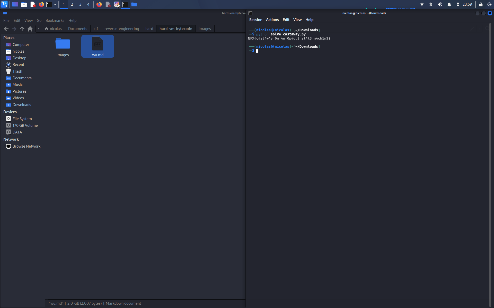

# Castaway — Writeup

## Soal
Binary mandiri yg baca calon flag dari stdin. Validasi nya lewat state machine kecil pake opaque predicate, transformasi per-byte yg melibatkan state, S-box, dan key, trs ada anti-debug pake `ptrace`. Tugas nya analisis trs cari input yg lolos.

## Recon
```bash
file castaway
strings -n 4 castaway
```

Binary nya stripped, tapi dari strings kelihatan ada `ptrace`, `memcmp`, dan prompt `flag> `, `Nope.`, `Access granted.` — jadi flow nya jelas, baca input lalu dibandingin.

## Anti-debug
Disassemble bagian awal main nya, ketemu panggilan `ptrace(PTRACE_TRACEME, ...)`. Kalo proses lagi di-trace (misal dibuka pake gdb), syscall ini return -1. Hasil return value nya (0 atau 1) di-XOR ke byte pertama hasil transformasi, jadi kalo didebug flag nya bakal salah secara diam-diam, bukan langsung keluar error. Karna kita ga pake debugger, nilainya 0 dan bisa diabaikan.

## Opaque predicate
State machine nya jalan dari state 0 ke 1 ke 2 ke 1 dst. Di state 2 ada cek `i*i & 3 == 2`. Ini ga pernah kesampe karna kuadrat mod 4 cuma bisa 0 atau 1, ga pernah 2. Jadi cabang ini cuma pengecoh, bisa diabaikan pas reverse.

## Cari data section
```bash
objdump -s -j .rodata -j .data castaway
```

Ketemu:
- S-box 256 byte di `0x2020`
- key 16 byte di `0x2120`
- target/ciphertext 40 byte di `0x2140`

## Transformasi per byte
Dari disassembly fungsi transform nya (state awal `s = 0xa5`), urutan per byte ke-`i`:

1. `t = input[i] ^ s`
2. `t = rotl8(t, i % 7 + 1)`
3. `t = (t + key[i & 15]) & 0xff`
4. `t = sbox[t]`
5. `t ^= (i * 47) & 0xff`
6. update state: `s = (s * 131 + t + i) & 0xff` (konstanta 131 muncul sebagai perkalian negatif `-125` krn compiler)

Hasil `t` di step 5 itu yg dibandingin ke target byte ke-`i`.

## Exploit
Karna state cuma gantung ke output (`t`) dan index `i`, tinggal jalanin kebalikan nya per byte, mulai dari target yg udah diketahui:

1. XOR dulu sama `(i*47) & 0xff`
2. invers S-box
3. kurangin key
4. rotate right balik
5. XOR sama state `s`

Trs update state pake rumus yg sama kyk forward (pake `t` = byte ciphertext, bukan hasil decrypt), soalnya state nya emang dihitung dari output bukan dari input.

Script ada di `solve_castaway.py`:

```bash
python3 solve_castaway.py castaway
```

Flag hasil decrypt dicoba lagi ke binary (`echo flag | ./castaway`), outputnya "Access granted." jadi udah bener.

## Flag



```
NFX{c4st4w4y_0n_4n_0p4qu3_st4t3_m4ch1n3}
```
