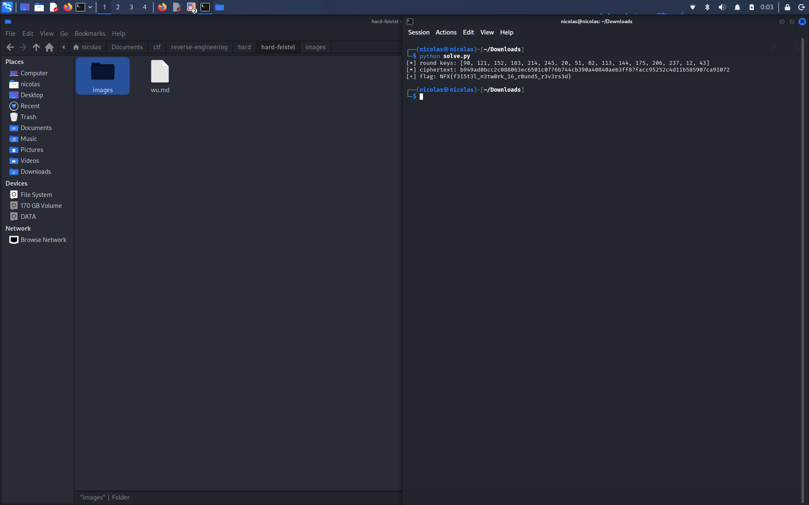

# hard_feistel

Soal ngasih binary ELF 64-bit `hard_feistel`, stripped, yg minta argumen flag trs dicek bener atau ngga.

```
$ ./hard_feistel
Pemakaian: ./hard_feistel <flag>
```

Deskripsi bilang flag dienkripsi pake jaringan Feistel 16 ronde, blok 32-bit (L sama R 16-bit masing2), round key dr jadwal simpel yg nempel di binary. Trs dikasih clue penting: Feistel itu invertible jd buat dekripsi ga perlu invert fungsi F-nya, cukup balik urutan rondenya aja.

## Bongkar binary

`file` bilang ini ELF PIE x86-64 stripped, kecil doang (~14KB). Langsung disassemble pake objdump:

```
objdump -d -M intel hard_feistel
```

Alur `main`-nya kira2 gini:

- cek `strlen(argv[1]) == 0x27` (39), kalo ga segitu langsung "Wrong!"
- input digandain ke buffer, dipad nol sampe 40 byte (10 blok x 4 byte)
- tiap blok diproses lewat loop Feistel
- hasil enkripsi 40 byte dibandingin pake `memcmp` ke array constant yg udah ketanem di `.data`

Bagian intinya ada di loop round:

```asm
119a: imul eax, ebx, 0x9e3779b1      ; F pake R
11a0: mov edx, ebp                   ; ebp = round key
11a2: shl edx, 8
11a5: add edx, ebp                   ; edx = key*257
11a7: shr eax, 5
11aa: xor eax, edx
11ac: movzx eax, ax                  ; potong ke 16-bit
11af: xor eax, esi                   ; eax = F(R,K) xor L
```

jd fungsi F-nya:

```
F(R, K) = (((R * 0x9e3779b1) >> 5) XOR (K * 257)) & 0xFFFF
```

trs tiap abis hitung F, ada swap standar Feistel di awal loop (`1190`):

```
L_baru = R_lama
R_baru = eax (hasil F diatas)
```

ronde pertama key-nya ketanem langsung sbg immediate `0x5a` (liat `mov ebp, 0x5a` sblm masuk loop pertama kali). Ronde 2 sampe 16 key-nya diambil dr tabel di `.rodata`, alamat `0x2064` sampe `0x209c`, maju 4 byte tiap ronde. Total 15 entry + 1 immediate = 16 round key, pas.

Dump `.rodata`:

```
objdump -s -j .rodata hard_feistel
```

```
2060 5a000000 79000000 98000000 b7000000
2070 d6000000 f5000000 14000000 33000000
2080 52000000 71000000 90000000 af000000
2090 ce000000 ed000000 0c000000 2b000000
```

kalo dibaca jadi dword little-endian: 90, 121, 152, 183, 214, 245, 20, 51, 82, 113, 144, 175, 206, 237, 12, 43. Selisih antar key konstan +31, wrap mod 256. Jadwalnya:

```
K_i = (90 + 31*(i-1)) mod 256
```

ciphertext target buat `memcmp` ada di `.data` offset `0x4020`, panjang 40 byte:

```
b949ad0b cc2c0880 63ec6501 c0776b74
4cb390a4 0840aeb3 ff87facc 95252c4d
11b58590 7ca91072
```

## Balikin Feistel-nya

Karena strukturnya standar (`L_i = R_{i-1}`, `R_i = L_{i-1} xor F(R_{i-1}, K_i)`), buat invert ronde tinggal:

```
R_{i-1} = L_i
L_{i-1} = R_i xor F(L_i, K_i)
```

jalanin mundur dr ronde 16 ke ronde 1 pake key yg kebalik urutannya, per blok 4 byte. Gandain buat 10 blok ciphertext, gabungin hasilnya, strip null padding di akhir, keluar deh flag-nya.

## Script

`solve.py` di bawah otomatis narik round key sama ciphertext langsung dr section binary (`.rodata` & `.data`) pake `pyelftools`, jd ga perlu copot angka manual tiap kali binary-nya beda:

```python
#!/usr/bin/env python3
import sys, struct
from elftools.elf.elffile import ELFFile

def get_section_bytes(path, name):
    with open(path, 'rb') as f:
        elf = ELFFile(f)
        sec = elf.get_section_by_name(name)
        return sec.data()

def F(R, K):
    val = (R * 0x9e3779b1) & 0xFFFFFFFF
    val = (val >> 5) & 0xFFFFFFFF
    val ^= (K * 257) & 0xFFFFFFFF
    return val & 0xFFFF

def decrypt_block(L, R, keys):
    for K in reversed(keys):
        L, R = (R ^ F(L, K)) & 0xFFFF, L
    return L, R

def main():
    path = sys.argv[1] if len(sys.argv) > 1 else './hard_feistel'
    rodata = get_section_bytes(path, '.rodata')
    data = get_section_bytes(path, '.data')

    keys = list(struct.unpack_from('<16I', rodata, 0x60))
    keys = [k & 0xFFFF for k in keys]

    ct = data[0x20:0x20 + 40]

    out = bytearray()
    for i in range(0, len(ct), 4):
        blk = ct[i:i+4]
        L = (blk[0] << 8) | blk[1]
        R = (blk[2] << 8) | blk[3]
        L0, R0 = decrypt_block(L, R, keys)
        out += bytes([L0 >> 8, L0 & 0xFF, R0 >> 8, R0 & 0xFF])

    print(out.split(b'\x00')[0].decode())

if __name__ == '__main__':
    main()
```

jalanin:

```
pip install pyelftools
python3 solve.py ./hard_feistel
```

dites juga balik ke binarynya buat mastiin:

```
$ ./hard_feistel "$(python3 solve.py ./hard_feistel)"
Correct! Jaringan Feistel berhasil dibalik.
```

## Flag

NFX{f315t3l_n3tw0rk_16_r0und5_r3v3rs3d}


