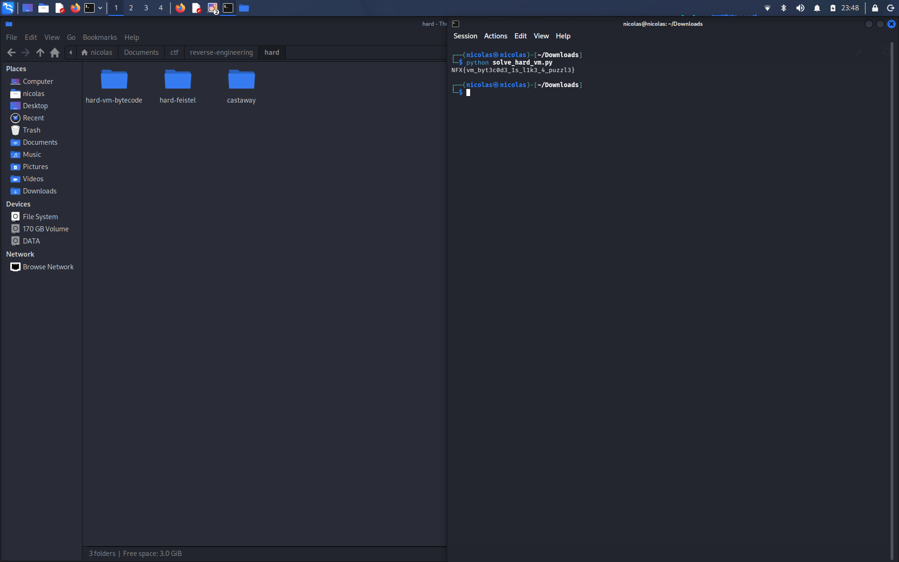

# Hard VM — Writeup

## Soal
Binary nya bukan validator biasa, dia jalanin bytecode custom di VM kecil. Tiap karakter diproses lewat urutan LOAD, XOR, ADD, ROL, trs CMP. Tugas nya reverse opcode nya dan balikin transformasi nya.

## Recon
Cek dulu file nya:

```bash
file hard_vm
strings -n 4 hard_vm
```

Ga ada key atau flag yg nongol langsung, berarti emang harus diintip lewat struktur VM nya.

## Cari data section
```bash
objdump -s -j .rodata -j .data hard_vm
```

Ketemu beberapa blok penting:
- S-box 256 byte
- key 16 byte
- bytecode program (di offset `0x2080`)
- target/ciphertext 33 byte yg bakal dibandingin pake CMP

## Reverse interpreter nya
Disassemble bagian loop utama:

```bash
objdump -d -M intel --no-show-raw-insn hard_vm
```

Interpreter nya baca instruksi 3 byte `(op, reg, imm)` trs dispatch lewat jump table. Dari tiap handler nya ketauan opcode nya:

| op | arti |
|----|------|
| 1  | LOAD — ambil `input[imm]` |
| 2  | XOR — `acc ^= imm` |
| 3  | ADD — `acc = (acc + imm) & 0xff` |
| 4  | ROL — rotate left `imm & 7` bit |
| 5  | CMP — bandingin acc sama target, kalo beda langsung "Wrong!" |
| 0xff | HALT — kalo sampe sini berarti lolos semua |

## Bongkar bytecode
`strlen` input harus 33 (`0x21`), jadi flag nya 33 karakter. Bytecode di `0x2080` berisi 166 instruksi: 33 grup `LOAD, XOR, ADD, ROL, CMP` (5 instruksi tiap grup) ditutup satu HALT di paling akhir. Index LOAD nya ga urut, jadi hasil decode nya ditulis ke posisi `idx` masing-masing, bukan posisi berurutan.

## Exploit
Tinggal balikin tiap step nya per grup:

1. `rotr(target, rol_amount)` — kebalikan dari ROL
2. kurangin `add_imm`
3. XOR sama `xor_imm`

Hasil nya ditaro di index yg sesuai (`idx`), gabungin semua jadi flag.

Script nya ada di `solve_hard_vm.py`:

```bash
python3 solve_hard_vm.py hard_vm
```

Abis dapet flag nya, langsung dicoba balik ke binary buat verifikasi dan outputnya "Correct!".

## Flag



```
NFX{vm_byt3c0d3_1s_l1k3_4_puzzl3}
```
