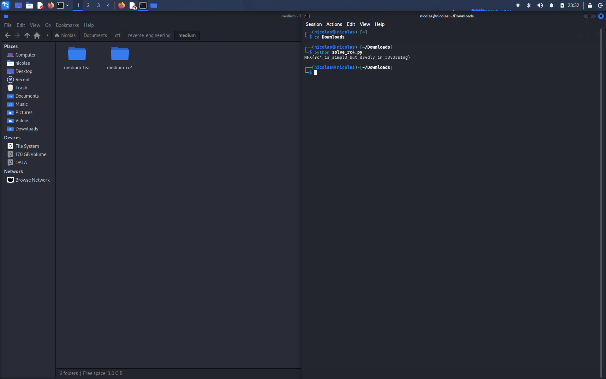

# Medium RC4 — Writeup

## Soal
Binary validator pake RC4, key nya udah ketanam langsung di binary. Ciphertext flag disimpen sebagai array byte. Karna RC4 itu simetris, dekripsi tinggal pake fungsi yg sama kyk enkripsi.

## Recon
Cek dulu jenis file nya:

```bash
file medium_rc4
strings -n 4 medium_rc4
```

Dari hasil strings langsung kelihatan ada key yg nyangkut: `n0t_s3cur3_k3y_2026`. Kemungkinan besar ini key RC4 nya, tinggal dicek dipake dimana.

## Cari ciphertext
Buka section data buat liat apa aja yg disimpen di binary:

```bash
objdump -s -j .rodata -j .data medium_rc4
```

Ketemu blok 42 byte di offset `0x2060`. Ukuran nya pas sama panjang flag yg biasa, jadi ini kemungkinan ciphertext yg bakal dibandingin pake `memcmp` sama hasil RC4(input).

## Exploit
Tinggal re-implement RC4 standar (KSA buat setup S-box, trs PRGA buat generate keystream), terus XOR ciphertext nya pake keystream itu. Karna RC4 simetris, proses enkripsi dan dekripsi sama persis.

Script nya ada di `solve_rc4.py`, tinggal jalanin:

```bash
python3 solve_rc4.py medium_rc4
```

Hasil decrypt nya langsung dicoba balik ke binary buat verifikasi, dan outputnya "Correct!" jadi udah fix bener.

## Flag



```
NFX{rc4_1s_s1mpl3_but_d34dly_1n_r3v3rs1ng}
```
