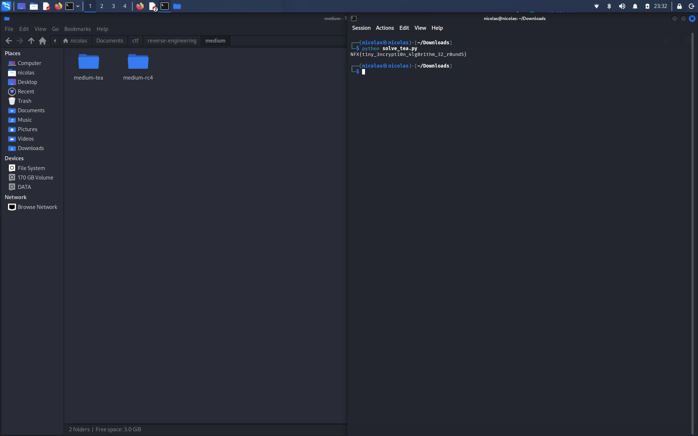

# Medium TEA — Writeup

## Soal
Validator pake TEA 32 round, key 128-bit nya ketanam di binary. Flag dipad nol sampe kelipatan 8 byte, trs tiap blok 64-bit dienkrip dan dibandingin sama ciphertext yg udah disimpen.

## Recon
Sama kyk biasa, cek file dan strings dulu:

```bash
file medium_tea
strings -n 4 medium_tea
```

Ga ada key yg nongol langsung kyk di rc4, berarti key nya kemungkinan ketanam sebagai immediate di instruksi, bukan di section data.

## Cari ciphertext dan key
Dump data section buat nyari ciphertext:

```bash
objdump -s -j .rodata -j .data medium_tea
```

Ketemu 40 byte (5 blok x 8 byte) di offset `0x2040`.

Buat key nya, harus disassemble bagian loop enkripsi:

```bash
objdump -d -M intel --no-show-raw-insn medium_tea
```

Loop nya kelihatan jelas pola TEA: ada delta `0x9e3779b9` (muncul sebagai `sub 0x61c88647` krn compiler pake substraction), dan sum berhenti di `0xc6ef3720` yg artinya 32 round. Key nya nongol sebagai 4 immediate 32-bit, dua diantaranya kebalik tanda (compiler pake `sub` bukan `add`):

- k0 = `0x1337beef`
- k1 = `0xcafebabe`
- k2 = `0xdeadc0de`
- k3 = `0x0badf00d`

## Exploit
Tinggal implement TEA decrypt standar (round function nya dibalik, mulai dari sum `delta*32` turun ke 0), jalanin per blok 64-bit little endian, gabungin hasilnya, strip padding nol di akhir.

Script ada di `solve_tea.py`:

```bash
python3 solve_tea.py medium_tea
```

Hasil nya dicoba balik ke binary dan outputnya "Correct!", jadi flag nya valid.

## Flag



```
NFX{t1ny_3ncrypt10n_4lg0r1thm_32_r0und5}
```
