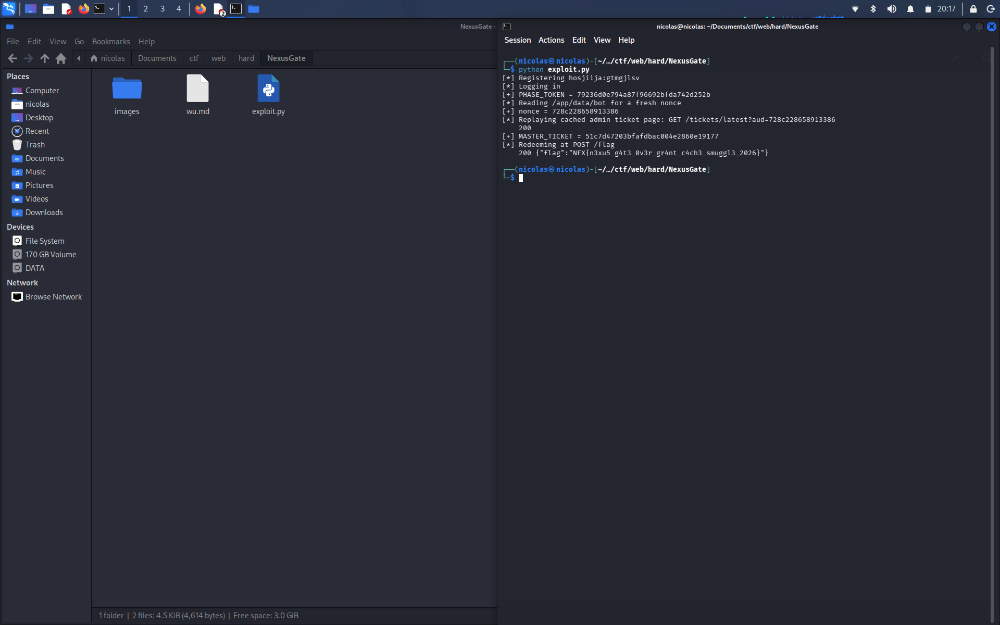

# NexusGate — Writeup


## Intro

NexusGate ini arsitekturnya ada 2 lapis: `proxy.js` (edge, port 80, pake undici) yg di depan, trs `app.js` (vault internal, cuma listen di `127.0.0.1:8080`). Jadi semua request publik lewat edge dulu sebelum nyampe ke backend. Dari source code yg dikasih, ada 3 bug yg bisa dirantai jadi full chain buat ambil flag.

## Bug 1 — ACL edge bisa dilewatin (parser differential)

Di `proxy.js`, cek ACL-nya gini:

```js
if (req.url.startsWith('/internal/')) {
  res.writeHead(403); res.end('forbidden'); return;
}
```

Cuma cek string mentah dr `req.url`. Tapi backend-nya (`routes.js`) parsing path pake:

```js
const url = new URL(req.url, 'http://127.0.0.1:8080');
```

`new URL()` itu ngikutin WHATWG spec, otomatis resolve segmen `.` / `..` sebelum jadi `pathname`. Jadi kalo kita kirim path yg secara string ga diawali `/internal/` tapi abis di-normalize jadi `/internal/...`, lolos dr cek edge tapi backend tetep nganggep itu internal route.

Tes lokal pake Node:
```
"/./internal/console/cursor"    -> pathname "/internal/console/cursor"
"/a/../internal/console/cursor" -> pathname "/internal/console/cursor"
```

Satu hal yg bikin stuck lumayan lama: kalo request-nya dikirim pake lib `requests` di python, dia **otomatis normalize dot-segment di path sebelum dikirim**. Jadi `requests.get(BASE + "/./internal/...")` ujung2nya yg beneran dikirim ke server udah jadi `/internal/...` — bypassnya ga kerasa krn client sendiri yg udah "ngebenerin" duluan. Solusinya kirim request mentah pake raw socket, request-line-nya ditulis manual biar ga dinormalize sama client.

## Bug 2 — IDOR gak ada auth di `/internal/console/cursor`

Endpoint ini cuma "dilindungi" ACL edge doang (yg udah bisa dilewatin di atas), gak ada cek session/role sama sekali di handler-nya sendiri. Parameter `owner` bebas diisi apa aja buat query ke tabel `vault`.

Trik tambahannya: pas `GET` step cursor, ada parameter `journal`. Kalo diisi username kita sendiri, baris vault (termasuk secret-nya) bakal ditulis ke journal milik kita, yg bisa dibaca lewat `/audit`. Jadi:

1. `POST /internal/console/cursor?id=X&owner=admin` — bikin cursor iterate vault row punya admin
2. `GET /internal/console/cursor?id=X&journal=<username_kita>` — step cursor, tulis hasilnya (termasuk secret) ke journal kita
3. `GET /audit` — baca journal kita, ketemu `PHASE_TOKEN` punya admin

## Bug 3 — bypass sandbox fs node buat baca nonce

`/internal/console/files` nge-spawn child process dgn flag:

```
--permission
--allow-fs-read=/app/data/bot1.json
--allow-fs-read=/app/data/bot2.json
--allow-fs-read=/app/data/bot3.json
```

trs child-nya jalanin `readFileSync(process.env.NX_TARGET)`. File yg kita incer `/app/data/bot` (nonce buat bot admin) bukan salah satu dr 3 file yg diizinin. Tapi pas dicoba langsung aja path `/app/data/bot` tanpa trik apa2, ternyata **tembus** — kebaca isinya. Kayaknya permission checker-nya salah arah pas ngecek prefix (ngecek apakah entry yg diizinin itu starts-with path yg diminta, bukan sebaliknya), jadi path yg lebih pendek dr nama file yg diizinin ikut lolos.

Isinya nonce hex, dan ternyata siklusnya cepet bgt (lebih cepet dr dugaan awal 45 detik), jadi nonce-nya berubah2 kalo kelamaan nunggu.

## Bug 4 — shared cache undici bocorin tiket admin

`GET /tickets/latest` cuma nyelipin `MASTER_TICKET` asli kalo session user-nya `admin`. Handler-nya coba nandain private:

```js
res.setHeader('Cache-Control', 'public, max-age=300, private=""');
```

`private=""` itu directive yg malformed, dan ini emang bug yg udah pernah dilaporin di undici (shared-cache disclosure, dibenerin di v7.29/v8.9) — respons yg niatnya private malah ke-cache jg di shared cache. Package.json pin `undici@7.28.0`, pas banget sebelum versi yg udah dipatch.

`lib/bot.js` jalan sbg admin tiap beberapa detik lewat gateway, mukul `/tickets/latest?aud=<nonce>`, nge-cache HTML yg isinya tiket asli di bawah URL persis itu. Nonce-nya ketulis ke `/app/data/bot` — yg udah kita bisa baca dr bug 3.

## Rangkai semuanya

1. Register + login akun biasa
2. Bypass ACL edge pake raw socket, request path `/./internal/console/cursor`
3. Bikin cursor `owner=admin`, step sambil `journal=<kita>` → dapet `PHASE_TOKEN`
4. Pake `PHASE_TOKEN` buat baca `/internal/console/files` dgn path `/app/data/bot` → dapet nonce segar
5. Langsung (jgn kelamaan, nonce cepet basi) `GET /tickets/latest?aud=<nonce>` lewat gateway → kena cache response admin yg isinya `MASTER_TICKET` asli
6. `POST /flag` dgn `MASTER_TICKET` → flag keluar

## Flag


